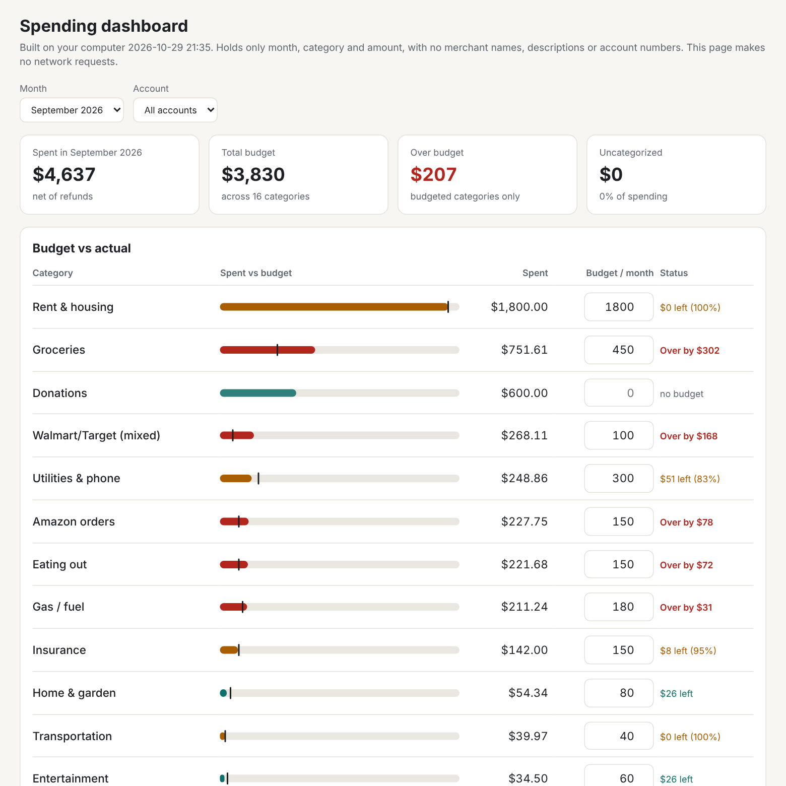
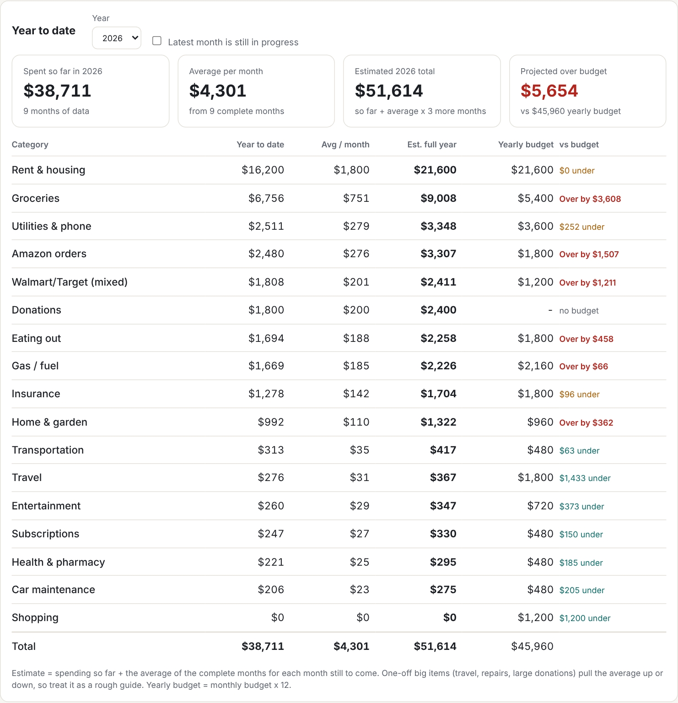

# Private spend tracker

Track your monthly spending against a budget **without giving anyone your bank data**.

Put your statements (CSV or PDF) in one folder on your computer. A small Python script reads them
there, throws away everything that could identify you, sorts spending into categories and builds a
dashboard that opens in your browser. Nothing is uploaded. The script never touches the network, and
you can check that yourself (see [How the privacy works](#how-the-privacy-works)).



- **Budget vs actual** for every category, by month, with over / near / under status
- **Year to date** with an estimated full-year total based on your monthly average
- **Monthly trend** for all spending or one category
- **Monthly updates:** drop in the new statement and run the same command; files already read are skipped
- Works on a phone-width screen and in dark mode. Offline. No account.

<p align="center"></p>

## Quick start

Needs Python 3.8+ (`python3 --version`). PDF statements also need `pip install pdfplumber`; CSV downloads
need nothing extra and are more reliable, so prefer the CSV option on your bank's website.

```bash
pip install .            # or: pipx install .      (adds the `spendscan` command)
# no install? skip this step and use  python3 scripts/spendscan.py  below
```

1. Make one folder, with a **subfolder per account** (use names that are not personal):
   ```
   my_statements/
     checking/   sep.csv  oct.csv
     credit_card/ sep.pdf
   ```
2. Run it:
   ```bash
   spendscan "my_statements" --open
   # without installing:
   python3 scripts/spendscan.py "my_statements" --open
   ```
3. Type a monthly budget next to each category in the dashboard. Press **Download budgets.csv**
   and save it over `my_statements/_spend_tracker/budgets.csv` to keep it.

Want to try it first? `python3 examples/generate_demo.py /tmp/demo && spendscan /tmp/demo --open`
creates nine months of fake statements.

## Every month

Download the new statement, put it in the right subfolder, run the same command. New transactions are added,
duplicates are ignored, and files that were already read are skipped.

## Fixing categories

Categories come from keywords (a built-in list of ~850 common US merchants), not AI. Your first run will leave
some purchases as **Uncategorized**. Open `_spend_tracker/unmatched_merchants.txt` (it stays on your computer) and add
lines to `_spend_tracker/categories.csv`, then run again:

A merchant keyword:

```csv
JOES PIZZA,Eating out
```

An exact amount (for Zelle/Venmo/check payments, whose names are never stored):

```csv
$2495.00,Rent & housing
```

Merge a whole category into another name:

```csv
@Groceries,Groceries & household
```

Your lines beat the built-in list, the longest match wins, and old months are updated on the next run.
Zelle/Venmo/check payments of $500 or more that have no label are listed in `payments_to_clarify.txt`
(amounts and months only, no names), because only you know what they were.

## How the privacy works

- **Runs on your computer.** Standard library only; the source has no network, subprocess or email code,
  and the tests fail if any gets added. Run it with Wi-Fi off if you want to be sure.
- **An allowlist, not a blocklist.** The dataset keeps only `month, category, amount, in/out, account label` and a salted
  one-way hash used to spot duplicates. Merchant names, descriptions, people's names, account numbers, exact dates,
  balances and file names are never written to it.
- **Safe to share:** `transactions.csv`, `budgets.csv` and `dashboard.html`. **Keep local:** `unmatched_merchants.txt`,
  `payments_to_clarify.txt` and the original statements.
- **The dashboard** is one HTML file with a strict content-security policy (`default-src 'none'`): it cannot make requests.
- Works as a **Claude skill** (see `SKILL.md`): Claude explains the steps and reads only the counts and totals you
  share, never your statements.

## Files it creates (inside `my_statements/_spend_tracker`)

| File | What it is |
|---|---|
| `dashboard.html` | The dashboard. Works offline. |
| `transactions.csv` | The scrubbed dataset. |
| `budgets.csv` | Your monthly budgets. |
| `categories.csv` | Your own rules. |
| `unmatched_merchants.txt` | **Local only.** Merchant text that needs a category. |
| `payments_to_clarify.txt` | **Local only.** Big Zelle/Venmo/check amounts that need a label. |
| `processed_files.csv` | Which files were already read (fingerprints only). |
| `last_run_report.txt` | What happened on the last run. |

## What it does not do

- It is only as good as its parsing. It has been tested on CSV layouts in the style of Chase, Amex, Capital One,
  Bank of America and Wells Fargo, and on text-based PDF statements, but not every bank. If yours fails, see
  [CONTRIBUTING.md](CONTRIBUTING.md): a fake example file with the same columns is all that is needed.
- PDF reading is best-effort. Scanned PDFs are not supported. Spot-check one month against your statement.
- Day-first dates (31/12/2026) are refused instead of guessed.
- Categories are keyword-based, so unusual merchants need a rule.
- The output still shows spending patterns. Treat the folder like any other financial record.
- Not financial, tax or legal advice.

## Development

```bash
python3 -m unittest discover -s tests -v     # standard library only
```

MIT licensed. See [CONTRIBUTING.md](CONTRIBUTING.md).
